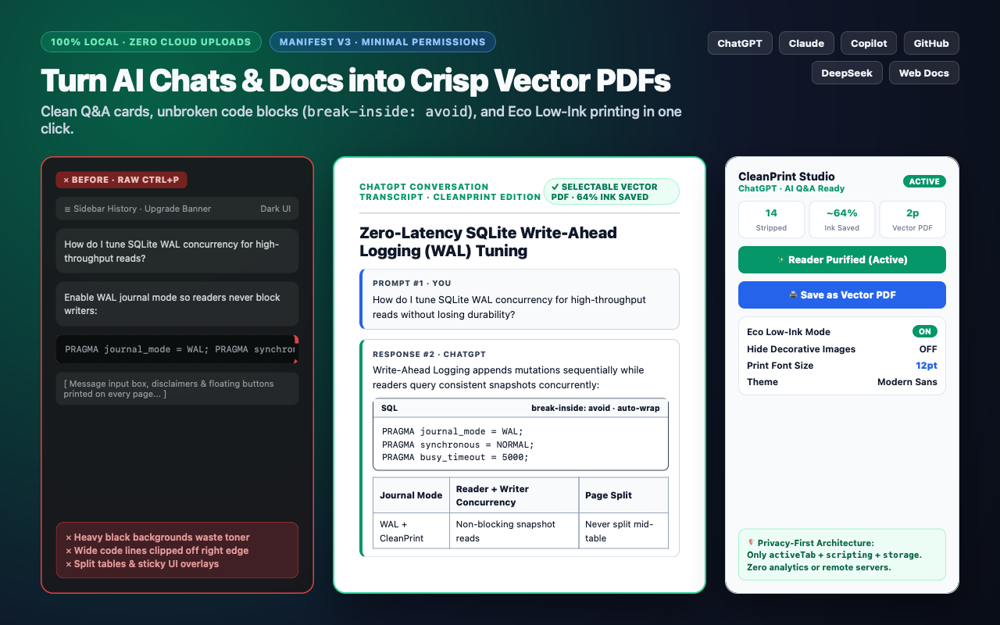
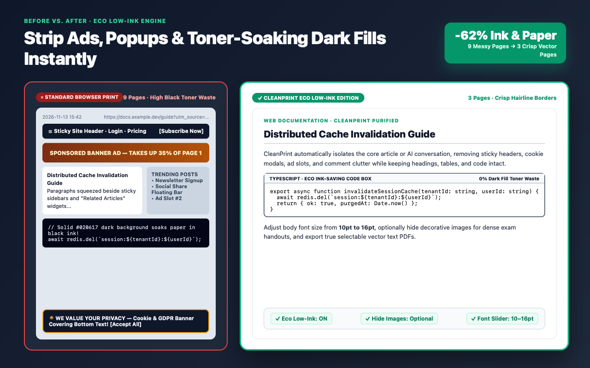
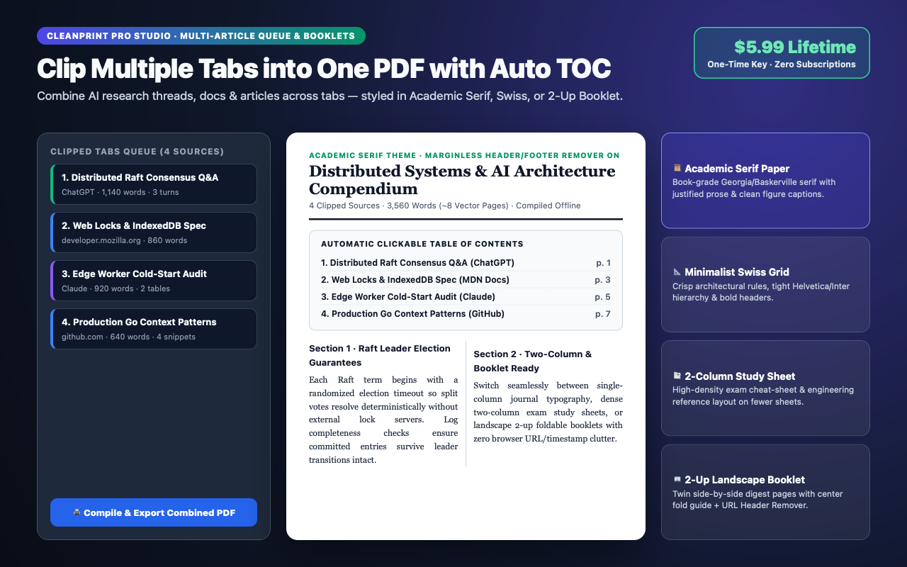

<div align="center">


# CleanPrint — Export ChatGPT, Claude, DeepSeek, Perplexity & Gemini to Clean Vector PDF & Markdown (`v1.1.1`)

**Export ChatGPT, Claude, DeepSeek, Perplexity & Gemini conversations to crisp vector PDFs (without cut-off code blocks) OR 1-click Obsidian/Notion Markdown (`.md`), using a 100% local dark-mode ink-saver browser extension.**

[](https://addons.mozilla.org/en-US/firefox/addon/cleanprint-ai-chat-to-pdf/)
[](https://github.com/963239327/cleanprint-ai-chat-to-pdf/releases/download/v1.1.1/cleanprint-studio-edge-chromium-v1.1.1.zip)
[](https://963239327.github.io/craftleaf-studio/extensions/cleanprint/)
[](https://stardustdemo.gumroad.com/l/cleanprint-pro)

-success)


[**Direct v1.1.1 Release →**](https://github.com/963239327/cleanprint-ai-chat-to-pdf/releases/tag/v1.1.1) · [**Chrome / Edge / Brave `.zip` →**](#option-2-install-on-chrome-microsoft-edge-brave--arc-v110) · [**Interactive Web Preview →**](https://963239327.github.io/craftleaf-studio/extensions/cleanprint/) · [**CleanPrint Pro ($5.99) →**](#free-vs-cleanprint-pro-comparison)

</div>

---

## Why Native `Ctrl+P` / `Cmd+P` Breaks on ChatGPT, Claude & Dark-Mode Docs

Anyone who has tried to **export ChatGPT to PDF without cut off code blocks** or **print a Claude conversation as a clean PDF** knows how broken default browser printing is on modern single-page AI apps:

1. **Nested Scroll Containers Truncate Long Threads**: ChatGPT, Claude, Copilot, DeepSeek, and Gemini wrap messages inside `height: 100vh; overflow-y: auto` flex shells—causing native `Cmd+P` to print **only Page 1** and clip everything else.
2. **Code Blocks & Markdown Tables Split Mid-Line or Overflow Horizontally**: `<pre><code>` blocks with `overflow-x: auto` slice off the right 40% of your SQL/Python/TypeScript code or split single statements across page boundaries.
3. **Dark Mode Drains Printer Toner**: Dark terminal backgrounds (`#0f172a` / `#1e293b`), sidebar chrome, sticky prompt boxes, and avatar badges flood pages with heavy black ink and unreadable low-contrast gray text.

**CleanPrint & AI-Chat to PDF Studio fixes all three locally in `<50ms`—with zero cloud servers, zero external libraries, and zero telemetry:**
- Parses ChatGPT, Claude, Microsoft Copilot, Gemini, DeepSeek, Perplexity, GitHub READMEs, MDN, and technical blogs into a clean, print-engineered AST.
- Wraps multi-line code blocks and wide Markdown tables (`white-space: pre-wrap; word-break: break-word; break-inside: avoid`) so **zero lines are ever cut off**.
- Includes a 1-click **Eco Low-Ink Mode** (a purpose-built **dark mode ink saver browser extension** stylesheet) that strips heavy dark fills down to crisp `#0f172a` hairline borders—saving up to **70% ink/toner** while keeping selectable vector text.

<p align="center">
  
</p>

---

## Key Features (100% Local & Privacy-First)

- **AI Chat Turn Extractor**: Automatically detects User Prompts vs. Assistant Responses across **ChatGPT**, **Claude**, **GitHub / Microsoft Copilot**, **Gemini**, **DeepSeek**, and **Perplexity**, formatting each turn with clear speaker badges (`PROMPT #1`, `RESPONSE #2`) and accent borders.
- **1-Click Clean Markdown (`.md`) Export (`v1.1.0`)**: Save any purified AI chat or technical article directly as an Obsidian / Notion / Logseq ready `.md` file with YAML frontmatter (`title`, `source`, `platform`, `exported_at`) and fenced code blocks.
- **Zero Cut-Off Code Blocks & Tables**: Replaces horizontal scrollbars with intelligent wrapping, language header badges (`SQL`, `PYTHON`, `TYPESCRIPT`, `BASH`), and `break-inside: avoid` pagination guards.
- **Dark Mode Ink Saver Stylesheet**: Strips dark UI backgrounds, cookie banners, sticky navbars, sidebars, ads, and comment widgets while preserving crisp monospace typography.
- **True Selectable Vector PDFs**: Uses your browser's native vector PDF engine—never blurry canvas screenshots—so exported PDFs remain searchable, copy-pasteable, and lightweight (`~80 KB` instead of `15 MB` PNGs).
- **Least-Privilege Manifest V3 Security**: Requests **only** `activeTab`, `scripting`, and `storage`. **No `<all_urls>` host permissions**, no background content scripts running on your tabs, and zero `.innerHTML` assignments.

<p align="center">
  
</p>

---

## Installation

### Option 1: Mozilla Firefox (1-Click Official Add-on)
Install directly from Mozilla Add-ons (signed & verified):
👉 **[CleanPrint & AI-Chat to PDF Studio on Firefox Add-ons](https://addons.mozilla.org/en-US/firefox/addon/cleanprint-ai-chat-to-pdf/)**

*(Or download [`cleanprint-studio-firefox-amo-v1.1.0.zip`](https://github.com/963239327/cleanprint-ai-chat-to-pdf/releases/download/v1.1.0/cleanprint-studio-firefox-amo-v1.1.0.zip) from [Releases (`v1.1.0`)](https://github.com/963239327/cleanprint-ai-chat-to-pdf/releases/tag/v1.1.0)).*

### Option 2: Install on Chrome, Microsoft Edge, Brave & Arc (`v1.1.0`)
Load the unpacked Manifest V3 release in 20 seconds:
1. Download **[`cleanprint-studio-edge-chromium-v1.1.0.zip`](https://github.com/963239327/cleanprint-ai-chat-to-pdf/releases/download/v1.1.0/cleanprint-studio-edge-chromium-v1.1.0.zip)** from [GitHub Releases (`v1.1.0`)](https://github.com/963239327/cleanprint-ai-chat-to-pdf/releases/tag/v1.1.0) and unzip it to a local folder (or clone this repo and select the `./src` directory).
2. Open your extensions management page:
   - **Chrome**: `chrome://extensions`
   - **Microsoft Edge**: `edge://extensions`
   - **Brave**: `brave://extensions`
3. Toggle **Developer mode** ON (top-right in Chrome/Brave, left sidebar in Edge).
4. Click **Load unpacked** and select the unzipped folder (containing `manifest.json`, or `./src` if cloned from Git).
5. Pin **CleanPrint** to your toolbar, open any ChatGPT / Claude thread or technical article, and click **Purify Article / AI Chat** → **Instant Print / Save Vector PDF**!

### Option 3: Interactive Browser Preview (No Install Needed)
Want to preview how CleanPrint formats AI conversations, Eco Low-Ink mode, and multi-tab research binders right in your browser?
👉 **[Open Interactive Web Preview (`craftleaf-studio/extensions/cleanprint`)](https://963239327.github.io/craftleaf-studio/extensions/cleanprint/)**

---

## How CleanPrint Purifies DOM & Print Media Under the Hood

```text
Live SPA DOM (ChatGPT / Claude / Docs)
  │
  ├─ 1. Platform & Turn Detector (`[data-message-author-role]`, `.font-claude-message`, density fallback)
  ├─ 2. Safe Block AST Extractor (Headings, Inline Runs, Code + Lang, Tables, Lists, Quotes, Figures)
  ├─ 3. Zero-innerHTML Renderer (`document.createElement` + `textContent` only — strict CSP compliant)
  └─ 4. Scoped Print Stylesheet (`html.cleanprint-studio-active body > *:not(#cleanprint-studio-root) { display: none }`)
        ├─ Unlocks viewport `100vh` / `overflow: hidden` traps across all pages
        ├─ Wraps `<pre class="cp-pre">` with `white-space: pre-wrap; break-inside: avoid`
        └─ Applies `.cp-low-ink` toner-saving monochrome borders for crisp laser/inkjet output
```

Repository layout:
- `src/purifier.js` — On-demand AI chat & article AST parser, live reader toolbar, and `@media print` stylesheet engine.
- `src/popup.html` / `src/popup.js` — Bilingual (EN / 中文) toolbar controller with live clutter & ink-savings estimator.
- `src/queue-studio.html` / `src/queue-studio.js` — Multi-tab PDF binder & automatic Table of Contents compiler.
- `src/manifest.json` — Chromium / Edge / Brave Manifest V3 (`service_worker`).
- `manifest.firefox.json` — Mozilla Firefox Manifest V3 (`background.scripts` + `browser_specific_settings.gecko`, zero data collection declared).

---

## Free vs. CleanPrint Pro Comparison

<p align="center">
  
</p>

The core reader purifier, AI-chat PDF exporter, font-size scaler, image hider, and Eco Low-Ink mode are **100% free and MIT open-source forever**. Optional one-time offline Pro keys support indie development and unlock power-user publishing workflows:

| Capability | Free Edition (`$0` Forever) | CleanPrint Pro (`$5.99` Lifetime) | Studio All-Access (`$19` Lifetime) |
| :--- | :---: | :---: | :---: |
| **ChatGPT, Claude, Copilot, Gemini & DeepSeek PDF Purifier** | ✅ | ✅ | ✅ |
| **Uncut Wrapped Code Blocks (`break-inside: avoid`) & Clean Tables** | ✅ | ✅ | ✅ |
| **Dark Mode Eco Low-Ink Stylesheet + Hide Images Toggle** | ✅ | ✅ | ✅ |
| **100% Local Offline Execution (Zero Cloud Uploads / Zero Tracking)** | ✅ | ✅ | ✅ |
| **Multi-Tab Print Queue + Automatic Linked Table of Contents** | — | ✅ | ✅ |
| **4 Pro Typography & Layout Themes** *(Academic Serif, Minimalist Swiss, 2-Column Study Sheet, 2-Up Booklet)* | — | ✅ | ✅ |
| **Marginless Browser URL / Date / Timestamp Header Remover** | — | ✅ | ✅ |
| **Unlocks All 5 CraftLeaf Studio Pro Tools** *(CleanPrint, PasteShield, IDPhoto 4×6, Invoice Studio, CardSheet)* | — | — | ✅ (Gumroad Master Key) |

- 🔑 **[Get CleanPrint Pro — $5.99 One-Time Lifetime Key (Zero Subscriptions)](https://stardustdemo.gumroad.com/l/cleanprint-pro)**
- 🌟 **[Get CraftLeaf All-Access Pass — $19 Lifetime Master Key for All 5 Tools](https://stardustdemo.gumroad.com/l/craftleaf-all-access)**

---

## Sister Privacy-First Tools by CraftLeaf Studio

- 🛡️ **[PasteShield — Reversible AI Prompt Secret Sanitizer (VS Code / Cursor / CLI)](https://github.com/963239327/pasteshield-secret-sanitizer)** — Redact `.env` keys, JWTs, AWS credentials & DB URIs into `<OPENAI_KEY_1>` before prompting ChatGPT/Claude and restore real secrets in 1 click.
- 🪪 **[Passport & Visa $0.39 4×6" Photo Sheet Maker](https://963239327.github.io/craftleaf-studio/tools/id-photo/)** — Tile 2×2" US Visa/Passport or 33×48mm photos onto a single 4×6" CVS/Walgreens print sheet 100% offline in your browser.
- 🗂️ **[CardSheet Duplex Flashcard & PnP Layout Studio](https://963239327.github.io/craftleaf-studio/cardsheet/)** — Perfect front/back duplex registration for printable study flashcards & tabletop prototypes.
- 🌿 **[Explore All Free Local Browser Tools at CraftLeaf Studio →](https://963239327.github.io/craftleaf-studio/)**

## License

Released under the [MIT License](./LICENSE). 100% client-side, zero analytics, zero telemetry.
